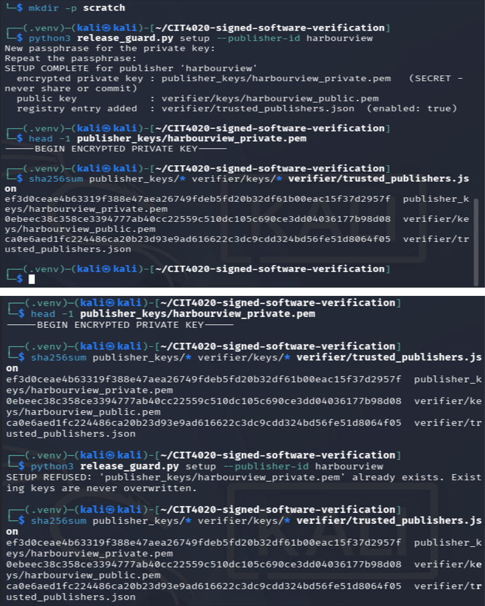
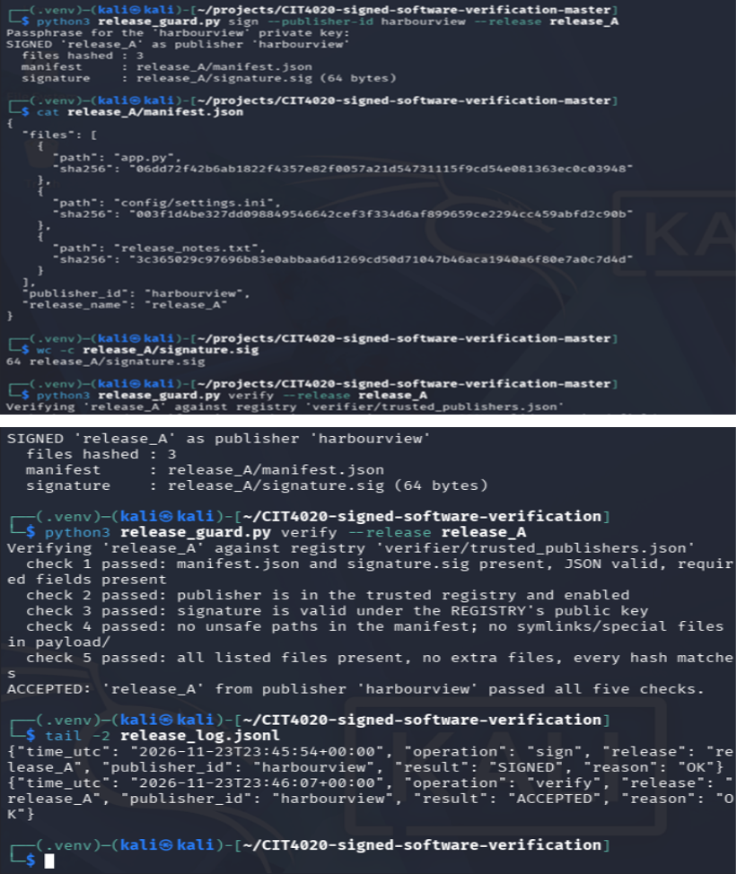
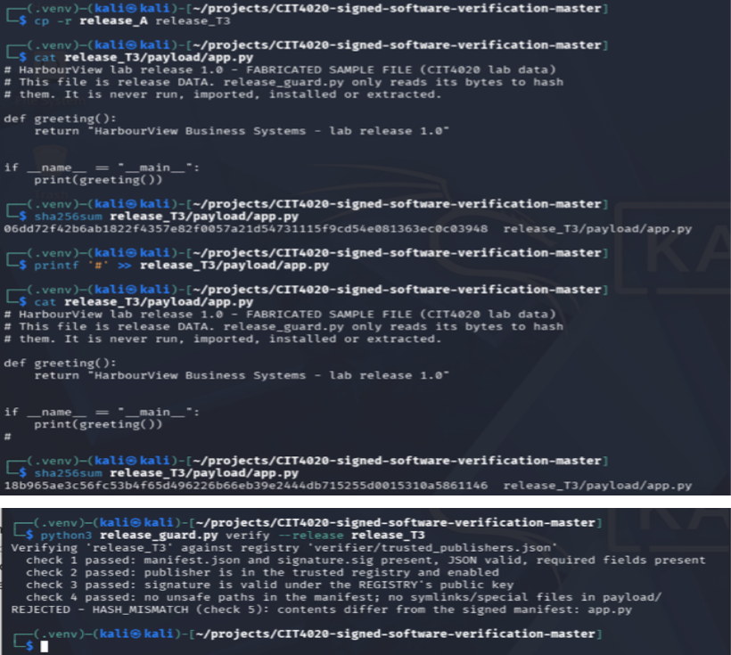
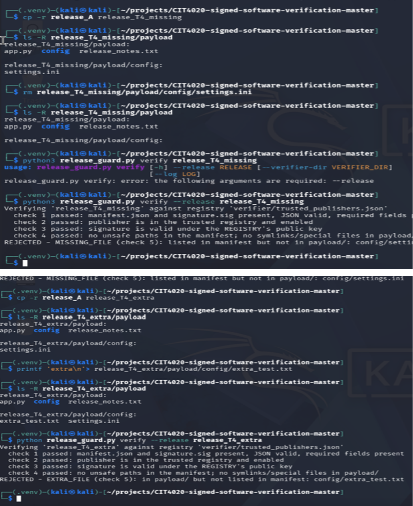
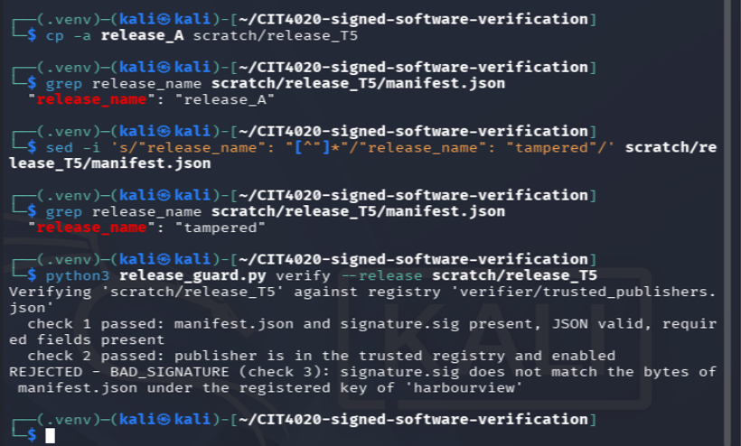

# release_guard: Signed Software Release Verification

CIT4020 Computer Security · Group Lab Project (Assignment 2) · Group **6** *(Anthony x Quan) +3*

The `release_guard.py` is a command-line tool project for a fictional client named HarbourView Business Systems Ltd. The tool lets a software publisher sign a release, and lets a client check that the release really came from a trusted publisher and hasn't been changed since it was signed

| Command  | Who runs it | What it does |
|----------|-------------|--------------|
| `setup`  | Publisher, once | Creates an Ed25519 key pair. The private key is saved **encrypted** (passphrase typed at a hidden prompt) in `publisher_keys/`. The public key and a registry entry (`enabled: true`) go into the client's `verifier/` folder. Refuses to overwrite existing keys. |
| `sign`   | Publisher, per release | Hashes every file in `<release>/payload/` (SHA-256), writes `manifest.json`, and signs the exact bytes of that manifest into `signature.sig` (raw 64-byte Ed25519 signature). |
| `verify` | Client (HarbourView) | Runs five checks **in order** and prints `ACCEPTED` only if all pass; otherwise `REJECTED - <REASON>` with details. |

Every `sign` and `verify` attempt, including failures, is appended to `release_log.jsonl`.

**Contents:**
1. [Project layout](#1-project-layout)
2. [How to Build and Run](#2-how-to-build-and-run)
3. [Quick start for the marker](#3-quick-start-for-the-marker)
4. [Tests and results](#4-tests-and-results)
5. [Design decisions](#5-design-decisions-the-groups-contract)
6. [Known limitations](#6-known-limitations)

---

## 1. Project layout

```text
release_guard.py            the whole tool (setup | sign | verify | log)
requirements.txt            pinned cryptography
release_A/                  sample signed release (payload/, manifest.json, signature.sig)
verifier/                   client trust store: trusted_publishers.json + keys/ (public only)
publisher_keys/             SECRET private keys - ignored by Git, never in the ZIP
tests/                      unittest suite, test matrix, workflow, T10b helper
evidence/                   test results + screenshots from the formal run
docs/                       project, build, testing, design, security, demo and report guides
reports/                    final deliverables (PDF, ZIP, MP4) before upload
scratch/                    throwaway test copies - ignored by Git
```

---

## 2. How to Build and Run

Target: **Python 3** on **Kali Linux or Ubuntu**, run from a terminal inside a virtual environment.
Every command below uses the real flags of `release_guard.py` (check with `--help`).

### 2.1 Prerequisites

```bash
sudo apt update
sudo apt install -y python3 python3-venv python3-pip git
python3 --version          # e.g. Python 3.12.x
```

- `python3`: the interpreter. Any 3.9 or newer works. We developed on 3.15 and you should test on your VM's version.
- `python3-venv`: creates an isolated environment, which avoids the "externally-managed-environment" pip error on Kali/Debian.
- `git`: version control. The ZIP is also built from it.

### 2.2 Create a virtual environment and install dependencies

```bash
cd CIT4020-signed-software-verification   # the project root (where release_guard.py is)
python3 -m venv .venv                     # create the environment (once)
source .venv/bin/activate                 # activate it (every new terminal); prompt shows (.venv)
pip install -r requirements.txt           # installs the pinned cryptography version
```

`.venv/` is in `.gitignore`. Never commit it or put it in the ZIP.

### 2.3 Verify the cryptography installation

```bash
pip show cryptography | head -n 2
python3 -c "from cryptography.hazmat.primitives.asymmetric.ed25519 import Ed25519PrivateKey; print('ok')"
python3 release_guard.py --help           # also: setup --help, sign --help, verify --help
```

`requirements.txt` pins `cryptography==50.0.2`. If your VM installs another version, run the tests
and update the pin to the version you actually tested.

### 2.4 setup (Part A, once per publisher)

```bash
python3 release_guard.py setup --publisher-id harbourview
```

- Asks for a passphrase twice at a **hidden** prompt. Nothing is shown as you type, which is normal.
- The passphrase must be at least 8 characters, and both entries must match.
- Creates `publisher_keys/harbourview_private.pem` (encrypted, owner-only permissions),
  `verifier/keys/harbourview_public.pem`, and a registry entry with `"enabled": true` in `verifier/trusted_publishers.json`.
- Running it again for the same id is **refused** and changes nothing.

### 2.5 sign (Part B)

```bash
python3 release_guard.py sign --publisher-id harbourview --release release_A \
        --release-name "HarbourView lab release 1.0"
```

- Asks for the passphrase (hidden) and unlocks the key **before** writing anything.
- Hashes every file in `release_A/payload/`, including subfolders, then writes `release_A/manifest.json` and `release_A/signature.sig` (64 bytes).
- A wrong or empty passphrase prints `SIGN FAILED - BAD_PASSPHRASE` and writes nothing.

### 2.6 verify (Part C) and the log (Part D)

```bash
python3 release_guard.py verify --release release_A
echo $?                    # 0 = ACCEPTED, 1 = REJECTED
cat release_log.jsonl      # one JSON line per sign/verify attempt
```

### 2.7 All flags

| Command | Flag | Default | Meaning |
|---------|------|---------|---------|
| setup | `--publisher-id` (required) | | Publisher id: letters, digits, `_`, `-` |
| setup | `--keys-dir` | `publisher_keys` | Publisher-side folder for the encrypted private key |
| setup | `--verifier-dir` | `verifier` | Client-side folder for `trusted_publishers.json` and `keys/` |
| sign | `--publisher-id` (required) | | Whose private key signs |
| sign | `--release` (required) | | Release folder containing `payload/` |
| sign | `--release-name` | release folder name | Value stored as `release_name` |
| sign | `--keys-dir` | `publisher_keys` | Where the private key is |
| sign | `--log` | `release_log.jsonl` | Log file |
| verify | `--release` (required) | | Release folder to check |
| verify | `--verifier-dir` | `verifier` | Which registry to trust |
| verify | `--log` | `release_log.jsonl` | Log file |

Passphrases are **never** command-line arguments. They are only typed at the hidden `getpass` prompt.

### 2.8 Understanding the output

**verify** prints one line per check as it passes, then exactly one result line:

```text
$ python3 release_guard.py verify --release release_A
Verifying 'release_A' against registry 'verifier/trusted_publishers.json'
  check 1 passed: manifest.json and signature.sig present, JSON valid, required fields present
  check 2 passed: publisher is in the trusted registry and enabled
  check 3 passed: signature is valid under the REGISTRY's public key
  check 4 passed: no unsafe paths in the manifest; no symlinks/special files in payload/
  check 5 passed: all listed files present, no extra files, every hash matches
ACCEPTED: 'release_A' from publisher 'harbourview' passed all five checks.

$ python3 release_guard.py verify --release scratch/release_T5
Verifying 'scratch/release_T5' against registry 'verifier/trusted_publishers.json'
  check 1 passed: manifest.json and signature.sig present, JSON valid, required fields present
  check 2 passed: publisher is in the trusted registry and enabled
REJECTED - BAD_SIGNATURE (check 3): signature.sig does not match the bytes of manifest.json under the registered key of 'harbourview'
```

- The "check N passed" lines show how far verification got. They are **not** acceptance.
- `ACCEPTED` appears only when all five checks pass.
- `REJECTED - <CODE> (check N): <detail>` names the failing check and says what was wrong (which file, which path).

**Log line** (`cat release_log.jsonl`):

```json
{"time_utc": "2026-11-20T19:13:08+00:00", "operation": "verify", "release": "release_T3", "publisher_id": "harbourview", "result": "REJECTED", "reason": "HASH_MISMATCH"}
```

### 2.9 Where the generated files are

| File | Created by | Side | Secret? |
|------|-----------|------|---------|
| `publisher_keys/<id>_private.pem` | setup | Publisher | **Yes**: encrypted, never committed or shipped |
| `verifier/keys/<id>_public.pem` | setup | Client | No |
| `verifier/trusted_publishers.json` | setup (then edited by the client admin) | Client | No, but must be protected from tampering |
| `<release>/manifest.json` | sign | Travels with the release | No |
| `<release>/signature.sig` | sign | Travels with the release | No |
| `release_log.jsonl` | sign and verify | Wherever you run the tool | No secrets inside |

### 2.10 Troubleshooting

| Symptom | Cause / fix |
|---------|-------------|
| `error: externally-managed-environment` from pip | You are not in the venv. Run `source .venv/bin/activate`. |
| `ModuleNotFoundError: No module named 'cryptography'` | The venv isn't active, or `pip install -r requirements.txt` was not run. |
| `SETUP REFUSED: ... already exists` | Working as designed: keys are never overwritten. To start again on purpose, follow TESTING_GUIDE T1 "clean state" (this destroys the old key). |
| `SIGN FAILED - MISSING_KEY` | No private key for that id in `--keys-dir`. Run setup, or pass the right `--keys-dir`. |
| `SIGN FAILED - BAD_PASSPHRASE` | Wrong or empty passphrase. If it is lost, the key is unusable: re-run setup **in a clean state** and re-sign, but only before the code freeze. |
| `SIGN FAILED - UNSAFE_PATH` | The payload contains a symlink, which is not allowed. Replace it with a real file. |
| `REJECTED - REGISTRY_ERROR` | `verifier/trusted_publishers.json` is missing or not valid JSON. The tool fails closed. Fix the registry. |
| `release_A` verifies on Windows but gives `HASH_MISMATCH` on Linux | Git converted line endings. `.gitattributes` prevents this; re-clone after it is committed. |
| `ImportError: DLL load failed ... filename or extension is too long` (Windows) | The project path is too long for Windows. Create the venv in a short path such as `C:\venvs\rg`. |
| Passphrase prompt shows a warning "Can not control echo" | You are running inside an IDE output pane, not a real terminal. Use a real terminal; never record a demo that way. |
| The private key is readable by others (`ls -l` is not `-rw-------`) | It was created on a filesystem without Unix permissions (e.g. a shared folder). Run on the VM's own disk. |

---

## 3. Quick start for the marker

The ZIP contains the signed `release_A/` and the **public** side of the trust store
(`verifier/trusted_publishers.json` + `verifier/keys/harbourview_public.pem`). It does **not**
contain the private key. Install first ([2.1](#21-prerequisites)–[2.2](#22-create-a-virtual-environment-and-install-dependencies)), then:

### Path A: verify the included signed release (no keys needed)

```bash
python3 release_guard.py verify --release release_A          # expect ACCEPTED
cp -a release_A /tmp/release_check
echo "#" >> /tmp/release_check/payload/app.py
python3 release_guard.py verify --release /tmp/release_check # expect HASH_MISMATCH
```

### Path B: start from scratch with your own publisher

The included registry already lists `harbourview`, so `setup` for that id is (correctly)
refused. Use separate folders instead:

```bash
mkdir -p /tmp/rg/myrelease && cp -a release_A/payload /tmp/rg/myrelease/
python3 release_guard.py setup  --publisher-id marker --keys-dir /tmp/rg/keys --verifier-dir /tmp/rg/verifier
python3 release_guard.py sign   --publisher-id marker --release /tmp/rg/myrelease --keys-dir /tmp/rg/keys --log /tmp/rg/log.jsonl
python3 release_guard.py verify --release /tmp/rg/myrelease --verifier-dir /tmp/rg/verifier --log /tmp/rg/log.jsonl
```

---

## 4. Tests and results

### Automated tests

```bash
python3 -m unittest discover -s tests -v
```

These run every T1–T10 scenario in temporary folders with a stubbed passphrase and never touch your real keys.
They are a development aid only. The **formal** T1–T10 evidence is captured by hand on the frozen code, following
[docs/TESTING_GUIDE.md](docs/TESTING_GUIDE.md). The automated tests are not a substitute for it.

### Test Results Preview (T1–T5)

Screenshots from the formal test run on a Kali Linux VM. The full T1–T10 table, with figures and the assessment of each run, is in [evidence/test_results.md](evidence/test_results.md). The original screenshots are in [evidence/screenshots/](evidence/screenshots/).

| T | Action | Expected result | Actual result | Pass/Fail |
|---|--------|-----------------|---------------|:---------:|
| [T1](#t1--setup-encrypted-key-refuses-to-overwrite) | `setup` from a clean state, show key header, `setup` again | ENCRYPTED header; second setup refused | `BEGIN ENCRYPTED PRIVATE KEY`; `SETUP REFUSED`; hashes identical before and after | ✅ Pass |
| [T2](#t2--sign-and-verify-release_a) | Sign `release_A`, show manifest, signature size and log, verify | ACCEPTED; log written | 64-byte signature; checks 1–5 passed, `ACCEPTED`; `SIGNED` and `ACCEPTED` log lines | ✅ Pass |
| [T3](#t3--one-character-edit-to-apppy) | Append one character to `app.py` in a copy, verify | REJECTED, HASH_MISMATCH | `REJECTED - HASH_MISMATCH (check 5): … app.py` | ✅ Pass |
| [T4](#t4--missing-file-and-extra-file) | Delete `config/settings.ini` in one copy; add `config/extra_test.txt` in another | MISSING_FILE; EXTRA_FILE | `REJECTED - MISSING_FILE (check 5)`; `REJECTED - EXTRA_FILE (check 5)` | ✅ Pass |
| [T5](#t5--manifest-edited-without-re-signing) | Edit `release_name` in `manifest.json` without re-signing, verify | REJECTED, BAD_SIGNATURE | `REJECTED - BAD_SIGNATURE (check 3)` | ✅ Pass |

#### T1 · Setup: encrypted key, refuses to overwrite

The passphrase prompt shows no echo, and the private key header reads `ENCRYPTED`. A second `setup` is refused, and the `sha256sum` of the keys and registry is identical before and after.

<p align="center">
  
</p>

#### T2 · Sign and verify `release_A`

`sign` hashes 3 files and writes `manifest.json` and a 64-byte `signature.sig`. `verify` passes all five checks, and the log records `SIGNED` and `ACCEPTED`.

<p align="center">
  
</p>

#### T3 · One-character edit to `app.py`

Appending `#` changes the file's hash (`06dd72f4…` → `18b965ae…`). Verification rejects it at check 5 and names `app.py`.

<p align="center">
  
</p>

#### T4 · Missing file and extra file

`ls -R` before and after each change. Deleting `config/settings.ini` gives `MISSING_FILE`, and adding the unlisted `config/extra_test.txt` in a subfolder gives `EXTRA_FILE`.

<p align="center">
  
</p>

#### T5 · Manifest edited without re-signing

`release_name` is changed from `release_A` to `tampered`. The signature no longer matches the manifest bytes, so verification stops at check 3.

<p align="center">
  
</p>

---

## 5. Design decisions (the group's "contract")

| Decision | What we chose |
|----------|---------------|
| CLI | `argparse` sub-commands `setup` / `sign` / `verify`; location flags so tests can use scratch folders. |
| Key files | `publisher_keys/<id>_private.pem` (PEM, PKCS8, encrypted with `BestAvailableEncryption`, mode 0600). `verifier/keys/<id>_public.pem` (PEM, SubjectPublicKeyInfo). |
| Passphrase | Hidden `getpass` prompt, asked twice at setup; empty or shorter than 8 characters refused. Never stored, printed, logged or accepted as an argument. |
| Registry | `verifier/trusted_publishers.json`: a JSON list of `{publisher_id, public_key_path, enabled}`. `public_key_path` is relative to the verifier folder. Re-read on every verify. `enabled` must be the JSON boolean `true` (the string `"true"` is not enough). |
| Manifest | `{publisher_id, release_name, files:[{path, sha256}]}`; paths relative to `payload/` with `/`, sorted; serialised once with `json.dumps(indent=2, sort_keys=True)` + newline, UTF-8. Those exact bytes are signed and written. |
| signature.sig | Raw 64-byte Ed25519 signature (nothing to decode). |
| Check order | 1 manifest -> 2 publisher -> 3 signature -> 4 paths -> 5 payload. First failing check wins. Inside check 5: `MISSING_FILE`, then `EXTRA_FILE`, then `HASH_MISMATCH`. |
| Path rule | Reject any manifest path that contains `..` (literal rule from the brief, so `notes..txt` is also rejected), starts with `/`, contains `\`, or starts with a drive letter. As defence in depth, the resolved path must stay inside `payload/`. |
| Symlinks | Not allowed. `sign` refuses a payload that contains symlinks or special files; `verify` rejects it with `UNSAFE_PATH` (check 4). |
| Empty payload / duplicates | `sign` refuses an empty payload. A manifest with an empty `files` list or a duplicate path is `INVALID_MANIFEST`. |
| Fail closed | Missing or corrupt registry -> `REGISTRY_ERROR` (never accept). Missing or corrupt public key -> `BAD_SIGNATURE`. |
| Exit codes | 0 = success / ACCEPTED, 1 = REJECTED / refused / failed, 2 = usage error. |
| Log | `release_log.jsonl`, one JSON object per line: `time_utc` (ISO-8601 UTC with offset), `operation`, `release`, `publisher_id` (null if unreadable), `result`, `reason`. Results: `SIGNED`/`FAILED` for sign, `ACCEPTED`/`REJECTED` for verify. Reason `OK` on success. |
| Line endings | `.gitattributes` stops Git rewriting `release_A/` line endings, which would break the hashes. |

### Reason codes

| Code | Command / check | Meaning |
|------|-----------------|---------|
| `INVALID_MANIFEST` | verify, check 1 | manifest.json or signature.sig missing, unreadable, bad JSON, wrong or missing fields, duplicate path |
| `UNKNOWN_PUBLISHER` | verify, check 2 | publisher_id not in the registry |
| `PUBLISHER_DISABLED` | verify, check 2 | in the registry but `enabled` is not `true` |
| `BAD_SIGNATURE` | verify, check 3 | signature does not verify under the registry key (or that key cannot be loaded) |
| `UNSAFE_PATH` | verify, check 4 / sign | path could escape `payload/`, or payload contains a symlink |
| `MISSING_FILE` | verify, check 5 | listed file not present |
| `EXTRA_FILE` | verify, check 5 | file present (any subfolder) but not listed |
| `HASH_MISMATCH` | verify, check 5 | file bytes differ from the signed hash |
| `REGISTRY_ERROR` *(extra)* | verify, check 2 | registry missing, corrupt, or lists the id twice: fail closed |
| `BAD_PASSPHRASE` *(extra)* | sign | wrong or empty passphrase; nothing written |
| `MISSING_KEY` *(extra)* | sign | no private key for this publisher id |
| `INVALID_RELEASE` *(extra)* | sign | no `payload/`, empty payload, or unreadable file |

The extra codes still need the lecturer's approval. If extras are not allowed,
`REGISTRY_ERROR` would become `UNKNOWN_PUBLISHER`, a one-line change in `check_2_publisher`.

---

## 6. Known limitations

- **The registry is the root of trust.** Anyone who can edit `verifier/` can add themselves or swap a public key, and their releases will be accepted (T10 scenario d; not part of the formal run). The bonus key fingerprint is not implemented.
- **No rollback protection.** The manifest has no version number or expiry, so an older, validly signed release is still accepted.
- **A stolen private key plus its passphrase** lets the thief sign releases that pass every check. The only response is to disable or remove the publisher and issue a new key.
- **The log is not tamper-evident.** It is a plain append-only text file that anyone with write access can edit.
- **A valid signature proves who and unchanged, not safe.** It says nothing about whether the software is harmless.
- On Windows, `0600` permissions on the private key are not enforced. Use the Linux VM.
