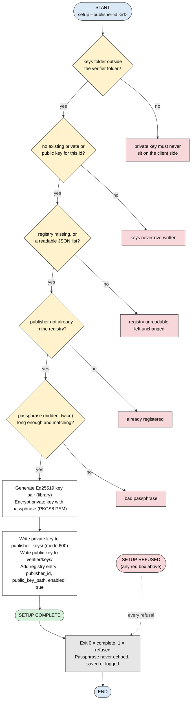
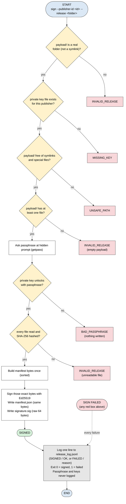

## Cover Page
--- 
# Project Overview
HarbourView Business Systems Ltd project is a command-line tool, `release_guard.py`. The tool lets a software publisher sign a release, and lets a client check that the release really came from a trusted publisher and hasn't been changed since it was signed

### The Workflow has three steps:
1. `setup` creates an Ed25519 key pair for a publisher. The private keys is encrypted with a passphrase and stays on the publisher's side. The public key and a registry entry go into the client's trust store. 
2. `sign` computes a SHA-256 hash of every file in the release's `payload/` folder. It writes the hashes to `manifest.json` and signs those exact bytes into `signature.sig`. 
3. `verify` runs five checks in order and stops at the first failure: 
	1. The manifest and signature exist and are valid. 
	2. The publisher is in the registry and enabled.
	3. The signature is valid under the public key from the registry, never a key shipped with the release. 
	4. No manifest path can escape `payload/`, and the folder has no symlinks or special files 
	5. Every listen file is present, there are no extra files, and every hash matches.

>**NOTE THAT:**
>The release is marked ACCEPTED only if all five pass. Otherwise it is strict safety rules: payload file are only read, never run; the passphrase is never stored or logged; and if the registry can't be read, verify rejects the release instead of accepting it.

--- 
# Risk Analysis

| #   | Threat                                                                                                                          | Security control the tool uses                                                                                                                                                                                                                                                                                                                                                                      | Remaining Risk                                                                                                                                                                                                                                                                                                               |
| --- | :------------------------------------------------------------------------------------------------------------------------------ | :-------------------------------------------------------------------------------------------------------------------------------------------------------------------------------------------------------------------------------------------------------------------------------------------------------------------------------------------------------------------------------------------------- | :--------------------------------------------------------------------------------------------------------------------------------------------------------------------------------------------------------------------------------------------------------------------------------------------------------------------------- |
| 1   | **Fake Publisher:** <br>An attacker ships a release signed with their own key, or includes their own public key in the release. | Check 2 accepts only publishers listen and `enabled: true` in the client's registry. The test is `is true`, so a string like `"false"` doesn't count as enabled. Check 3 verifies the signature using the public key named the public key named in the **registry**, never a key that comes with the release. Unknown publishers get `UNKNOWN_PUBISHER` and disabled ones get `PUBLISHER_DISABLED`. | Trust depends on how the public key first reached the registry. If an attacker's key is registered during setup, or someone registers the wrong key by mistake, their releases will pass. Nothing checks the key's fingerprint out of band.                                                                                  |
| 2   | **Modified, added or removed payload files:** <br>For example malware is slipped into a release after signing.                  | `sign` hashes every file with SHA-256 and sign the exact bytes of the manifest using Ed25519. <br>Check 5 rejects with `MISSING_FILE`, `EXTRA_FILE` or `HASH_MISMATCH`, and compares hashes with `hmac.compare_digest`. <br>Check 4 blocks `..`, absolute paths, backslashes, drive letters and symlinks (`UNSAFE_PATH`).                                                                           | **Time-of-check to Time-of-use:**<br>A file could swapped after verify accepts it but before it is installed. Verify also can't tell whether the publisher signed bad code on purpose or by accident. And an old, validly signed release can be replayed, because there is no version or expiry check.                       |
| 3   | **Stolen Private Key:**<br>Someone copies the key file from the publisher's machine.                                            | The private key is encrypted with a passphrase of at least 8 characters, entered at a hidden `getpass` prompt and never stored or logged. The key files is created with `0o600` permissions using `0_EXCL`, so it is never overwritten. Setup also refuses to put the keys folder inside the verifier folder.                                                                                       | Anyone with the file can try to guess the passphrase using offline cracking methods, and 8 characters may be weak. If the passphrase is also leaked, the attacker can sign releases until the publisher is set to disabled by hand. There is no revocation list and no key rotation. On Windows, `0o600` is largely ignored. |
| 4   | **Tampered or corrupted registry:**<br>An attacker edits `trusted_publishers.json` to add their key or re-enable a publisher.   | The registry is re-read from disk on every verify, with no caching. If it is missing, corrupt or the wrong shape, verify **fails closed** with `REGISTRY_ERROR`, and it does the same for duplicate publisher entries. Setup refuses to modify a registry it can't read.                                                                                                                            | The registry itself isn't signed or integrity-protected. Anyone who can write to the verifier folder can add a trusted publisher or swap a public key, and verify will then accept their releases. Its security rests entirely on the client machine's file permissions.                                                     |

--- 
# Design 

The three commands of `release_guard.py` are shown below as flowcharts. Each one follows the same pattern: run every check in order, stop at the first failure, and pass through a single exit point that sets the exit code (and, for `sign` and `verify`, writes one line to the log).

### 1. Setup

`release_guard.py setup`: CHECK, then ASK, then WRITE, so a refusal changes nothing.



### 2. Sign

`release_guard.py sign`: nothing is written unless every step passes.




### 3. Verify: the five checks

`release_guard.py verify`: five checks in order (first failing check wins, then stop).


--- 
# Test Results 

---

### Group (6) Main Objective
 - Build the tool (`setup`, `sign`, `verify`, followed by logging);
 - Test the tool with 10 Tiers ranging from Tier 1 - Tier 10, document screenshot based on these test.
 - Write a report inclusive of (risk analysis, design, results, reflection, contributions, AI declaration);
 - Submit a source ZIP and a 3 - 4 Minute DEMO Video;
 - **Every Member** explain the code in a live demo 
 
--- 

## How signed release verifications works three layers 

| Layer                           | What it does                                                                                                                                                       | What it cannot do Alone                                                                                |
| :------------------------------ | :----------------------------------------------------------------------------------------------------------------------------------------------------------------- | :----------------------------------------------------------------------------------------------------- |
| **HASH (SHA-256)**              | A 64-hex-character fingerprint of a file's exact bytes. Change one byte and the hash changes completely.                                                           | It has no secret, so an attacker can compute a matching hash for their altered file.                   |
| **Digital Signature (Ed25519)** | The publisher's private key signs the manifest (the list of hashes). Anyone with the **public  key** can check it, but only the private-key holder can produce it. | It cannot say whether the key belongs to someone you should trust; an attacker can with their own key. |
| **Trust Decision (Registry)**   | The Client's own list of approved publishers and their public keys, with an on/off switch.                                                                         | It is only as safe as the registry file itself.                                                        |
## Key ideas in one line each

 - **SHA-256:** A one-way function. It is easy to compute and practically impossible to find two files with the same hash. 
 - **Ed25519:** A modern elliptic-curve signature scheme with 64-byte signatures, fast and hard to misuse. We use the `cryptography` (based on recommendations from Claude) library's implementation, never or our own library.
 - **Private Key:** Stays with the publisher, encrypted with a passphrase. Whoever holds it is the publisher.
 - **Public Key:** Given to clients. It can only check signatures, not make them.
 - **Trusted Publisher:** A registry entry `{publisher_id, public_key_path, enables}` on the client's side. 
 - **Manifest:** `manifest.json`, which lists every payload file with its SHA-256. Signing the manifest indirectly signs every file through its hash. 

## Project Workflow
 
```text
Publisher: setup (once) => sign release_A/ (payload + manifest + signature)
Client: (receives public key + registry entry out of band) => verify release_A
```

### Part A: Setup & Keys

**GOAL:**
A one-time command that create an ED25519 key pair, saves the encrypted private key using a passphrase from a hidden prompt), then saves the public key in verifier folder, that creates `trusted_publishers.json` and refuses to overwrite Existing keys.

**Why Does this matters:**
The private key is the publisher's identity. Whoever holds it can sign anything the client will accept. Encrypting the private key means a stolen file alone isn't enough, and refusing to overwrite means a slip of the keyboard can't destroy the only key create by the publisher.

### Part B: Sign a Release 

**What is the Release** 
A release is a folder that holds a software version a publisher wants to ship to the client (HarbourView)

``` text 
release_A/
├── payload/              ← the publisher's actual files (e.g. app.py)
├── manifest.json         ← created by 'sign'
└── signature.sig         ← created by  'sign'
```

**GOAL:**


**Why does this matters:**
The manifest turns "a folder of files" into one small, signable statement. Once the manifest is sign every file through it's hash is also signed. The catch is that the signature is over bytes, not over "The same JSON".

### Part C: Verify a Release 

**GOAL:**
Run five checks **in order.** Print **Accepted** only if every check passes; otherwise print **REJECTED** and the reason, and stop at the first failure.

**The Five(5) Checks 'In order':**

| #   | Check                                                                           |             Rejection Reason              | What it protects, and what it reads                                                                                        |
| :-- | ------------------------------------------------------------------------------- | :---------------------------------------: | :------------------------------------------------------------------------------------------------------------------------- |
| 1   | `mainfest.json` and `signture.sig` exit; JSON readable; required fields present |             INVALID_MANIFEST              | `release_guard.py`: The junk input must produce a clean rejection, not a crash. Reads the two release files as raw bytes.  |
| 2   | `publisher_id` is in the registry and `enabled`                                 |  UNKNOWN_PUBLISHER / PUBLISHER_DISABLED   | **Whose** key to trust, a client-side decision. Reads the registry.                                                        |
| 3   | Signature valid using the public key **from the registry**                      |               BAD_SIGNATURE               | That the manifest is unchanged and was made by the key holder. Reads the registry's public key and the raw manifest bytes. |
| 3   | No manifest path contains `..` or starts with  `/`                              |                UNSAFE_PATH                | Stops the tool reading files outside `payload/` even if the manifest is validly signed. Reads only manifest text.          |
| 5   | Every listed files exists, no extras, every recomputed hash matches             | MISSING_FILE / EXTRA_FILE / HASH_MISMATCH | That the real payload matches what was signed. The only check that touches **`payload/`**                                  |
**The logic of the order:**
Structure comes first, because if the data isn't parsed then the data can't be used. 
- Identity comes before the signature check, because the registry's key is needed to check the signature. 
- Authenticity comes before trusting the manifest's contents (**`an unauthenticated manifest is an attcker-controlled text`**). Path safety comes before any payload file is opened. (Edit here and check the project plan document).

## Part D: Log 
**GOAL:**
Append one line to `release_log.json` for **every sign or verify attempt:** UTC time, operation, release folder, `publisher_id`, result, reason. Publishers should never log keys or passphrases.