## Cover Page
--- 
# Project Overview

The `release_guard.py` is a command-line tool project for a fictional client named HarbourView Business Systems Ltd. The tool lets a software publisher sign a release, and lets a client check that the release really came from a trusted publisher and hasn't been changed since it was signed

## Project Workflow
 
```text
Publisher: setup (once) => sign release_A/ (payload + manifest + signature)
Client: (receives public key + registry entry out of band) => verify release_A
```

### The Workflow has three steps:
1. `setup` creates an Ed25519 key pair for a publisher. The private keys is encrypted with a passphrase and stays on the publisher's side. The public key and a registry entry go into the client's trust store. 
2. `sign` computes a SHA-256 hash of every file in the release's `payload/` folder. It writes the hashes to `manifest.json` and signs those exact bytes into `signature.sig`. 
3. `verify` runs five checks in order and stops at the first failure: 
	1. The manifest and signature exist and are valid. 
	2. The publisher is in the registry and enabled.
	3. The signature is valid under the public key from the registry, never a key shipped with the release. 
	4. No manifest path can escape `payload/`, and the folder has no symlinks or special files 
	5. Every listen file is present, there are no extra files, and every hash matches.

>**NOTE THAT:**
>The release is marked ACCEPTED only if all five pass. Otherwise it is strict safety rules: payload file are only read, never run; the passphrase is never stored or logged; and if the registry can't be read, verify rejects the release instead of accepting it.

--- 
# Risk Analysis

| #   | Threat                                                                                                                          | Security control the tool uses                                                                                                                                                                                                                                                                                                                                                                      | Remaining Risk                                                                                                                                                                                                                                                                                                               |
| --- | :------------------------------------------------------------------------------------------------------------------------------ | :-------------------------------------------------------------------------------------------------------------------------------------------------------------------------------------------------------------------------------------------------------------------------------------------------------------------------------------------------------------------------------------------------- | :--------------------------------------------------------------------------------------------------------------------------------------------------------------------------------------------------------------------------------------------------------------------------------------------------------------------------- |
| 1   | **Fake Publisher:** <br>An attacker ships a release signed with their own key, or includes their own public key in the release. | Check 2 accepts only publishers listen and `enabled: true` in the client's registry. The test is `is true`, so a string like `"false"` doesn't count as enabled. Check 3 verifies the signature using the public key named the public key named in the **registry**, never a key that comes with the release. Unknown publishers get `UNKNOWN_PUBISHER` and disabled ones get `PUBLISHER_DISABLED`. | Trust depends on how the public key first reached the registry. If an attacker's key is registered during setup, or someone registers the wrong key by mistake, their releases will pass. Nothing checks the key's fingerprint out of band.                                                                                  |
| 2   | **Modified, added or removed payload files:** <br>For example malware is slipped into a release after signing.                  | `sign` hashes every file with SHA-256 and sign the exact bytes of the manifest using Ed25519. <br>Check 5 rejects with `MISSING_FILE`, `EXTRA_FILE` or `HASH_MISMATCH`, and compares hashes with `hmac.compare_digest`. <br>Check 4 blocks `..`, absolute paths, backslashes, drive letters and symlinks (`UNSAFE_PATH`).                                                                           | **Time-of-check to Time-of-use:**<br>A file could swapped after verify accepts it but before it is installed. Verify also can't tell whether the publisher signed bad code on purpose or by accident. And an old, validly signed release can be replayed, because there is no version or expiry check.                       |
| 3   | **Stolen Private Key:**<br>Someone copies the key file from the publisher's machine.                                            | The private key is encrypted with a passphrase of at least 8 characters, entered at a hidden `getpass` prompt and never stored or logged. The key files is created with `0o600` permissions using `0_EXCL`, so it is never overwritten. Setup also refuses to put the keys folder inside the verifier folder.                                                                                       | Anyone with the file can try to guess the passphrase using offline cracking methods, and 8 characters may be weak. If the passphrase is also leaked, the attacker can sign releases until the publisher is set to disabled by hand. There is no revocation list and no key rotation. On Windows, `0o600` is largely ignored. |
| 4   | **Tampered or corrupted registry:**<br>An attacker edits `trusted_publishers.json` to add their key or re-enable a publisher.   | The registry is re-read from disk on every verify, with no caching. If it is missing, corrupt or the wrong shape, verify **fails closed** with `REGISTRY_ERROR`, and it does the same for duplicate publisher entries. Setup refuses to modify a registry it can't read.                                                                                                                            | The registry itself isn't signed or integrity-protected. Anyone who can write to the verifier folder can add a trusted publisher or swap a public key, and verify will then accept their releases. Its security rests entirely on the client machine's file permissions.                                                     |

--- 
# Design 

The three commands of `release_guard.py` are shown below as flowcharts. Each one follows the same pattern: run every check in order, stop at the first failure, and pass through a single exit point that sets the exit code (and, for `sign` and `verify`, writes one line to the log).

### 1. Setup

`release_guard.py setup`: CHECK, then ASK, then WRITE, so a refusal changes nothing.


### 2. Sign

`release_guard.py sign`: nothing is written unless every step passes.


### 3. Verify: the five checks

`release_guard.py verify`: five checks in order (first failing check wins, then stop).

```mermaid
flowchart TD
    START(["START<br>verify --release &lt;folder&gt;"])
    C1a{"1a · manifest.json and<br>signature.sig exist?"}
    C1b{"1b · manifest is<br>valid UTF-8 JSON?"}
    C1c{"1c · required fields<br>well formed, no<br>duplicate paths?"}
    RAW["Keep RAW manifest bytes + signature<br>Read publisher_id (not yet trusted)"]
    C2a{"2a · registry readable<br>and a JSON list?"}
    C2b{"2b · publisher_id<br>in registry?"}
    C2c{"2c · exactly one<br>entry for it?"}
    C2d{"2d · enabled is True?<br>(strict, not truthy)"}
    C3a{"3a · registry public key<br>loads as Ed25519?"}
    C3b{"3b · signature valid over<br>RAW manifest bytes?"}
    C4a{"4a · every manifest<br>path safe?"}
    C4b{"4b · payload/ free of<br>symlinks / special files?"}
    SETS["listed = paths in manifest<br>present = regular files in payload/"]
    C5a{"5a · every listed<br>file present?"}
    C5b{"5b · no unlisted<br>files in payload/?"}
    C5c{"5c · every SHA-256<br>matches manifest?"}
    ACC(["ACCEPTED<br>(only place it is produced)"])

    R1a["INVALID_MANIFEST<br>(file is missing)"]
    R1b["INVALID_MANIFEST<br>(not valid JSON)"]
    R1c["INVALID_MANIFEST<br>(wrong or missing field)"]
    R2a["REGISTRY_ERROR<br>(fail closed)"]
    R2b["UNKNOWN_PUBLISHER"]
    R2c["REGISTRY_ERROR<br>(duplicate entry)"]
    R2d["PUBLISHER_DISABLED"]
    R3a["BAD_SIGNATURE<br>(trusted key unusable)"]
    R3b["BAD_SIGNATURE"]
    R4a["UNSAFE_PATH<br>(.., leading /, backslash,<br>drive letter, escapes payload/)"]
    R4b["UNSAFE_PATH<br>(symlink or special file)"]
    R5a["MISSING_FILE"]
    R5b["EXTRA_FILE"]
    R5c["HASH_MISMATCH<br>(names the file)"]

    REJ(["REJECTED<br>(any red box above)"])
    FIN["finish_verify() — single exit point<br>Print ACCEPTED / REJECTED + reason + check no.<br>Append one line to release_log.jsonl<br>Exit 0 = ACCEPTED, 1 = REJECTED"]
    END(["END"])

    START --> C1a
    C1a -- yes --> C1b -- yes --> C1c -- yes --> RAW --> C2a
    C2a -- yes --> C2b -- yes --> C2c -- yes --> C2d -- yes --> C3a
    C3a -- yes --> C3b -- yes --> C4a -- yes --> C4b -- yes --> SETS --> C5a
    C5a -- yes --> C5b -- yes --> C5c -- yes --> ACC

    C1a -- no --> R1a
    C1b -- no --> R1b
    C1c -- no --> R1c
    C2a -- no --> R2a
    C2b -- no --> R2b
    C2c -- no --> R2c
    C2d -- no --> R2d
    C3a -- no --> R3a
    C3b -- no --> R3b
    C4a -- no --> R4a
    C4b -- no --> R4b
    C5a -- no --> R5a
    C5b -- no --> R5b
    C5c -- no --> R5c

    R1a ~~~ R1b ~~~ R1c ~~~ R2a ~~~ R2b ~~~ R2c ~~~ R2d ~~~ R3a ~~~ R3b ~~~ R4a ~~~ R4b ~~~ R5a ~~~ R5b ~~~ R5c ~~~ REJ

    ACC --> FIN
    REJ -. "every failure" .-> FIN
    FIN --> END

    classDef term fill:#dbe8f5,stroke:#333,color:#000
    classDef check fill:#fff2cc,stroke:#333,color:#000
    classDef step fill:#ffffff,stroke:#333,color:#000
    classDef reject fill:#f8d7da,stroke:#333,color:#000
    classDef ok fill:#d5f0d9,stroke:#333,color:#000
    classDef exit fill:#e6e6e6,stroke:#333,color:#000
    class START,END term
    class C1a,C1b,C1c,C2a,C2b,C2c,C2d,C3a,C3b,C4a,C4b,C5a,C5b,C5c check
    class RAW,SETS step
    class R1a,R1b,R1c,R2a,R2b,R2c,R2d,R3a,R3b,R4a,R4b,R5a,R5b,R5c,REJ reject
    class ACC ok
    class FIN exit
```




--- 
# Test Results 

---

### Formal test results (T1–T10)

All ten brief tests were run against `release_guard.py` and recorded with terminal screenshots in `evidence/screenshots/T1` … `T10`. The full record, with the actual output, the T10 prediction record and the assessment of each tester's notes, is in [`evidence/test_results.md`](../evidence/test_results.md). Testers: NB (Nicolai Brooks, T1–T5, Kali VM, 22 Nov 2026), TC (re-run of T1–T5, Kali VM, 23 Nov 2026) and RF (Ryeem Fletcher, T6–T10, Kali on WSL, 23 Nov 2026), using Python 3 with `cryptography 50.0.2`.

| T              | Action                                                                                                  | Expected result                                                   | Actual result                                                                                                                                             | Pass/Fail                                               | Figure                       |
| -------------- | ------------------------------------------------------------------------------------------------------- | ----------------------------------------------------------------- | --------------------------------------------------------------------------------------------------------------------------------------------------------- | ------------------------------------------------------- | ---------------------------- |
| T1             | Ran `setup` from a clean state, showed the key header, ran `setup` again                                | Header says ENCRYPTED; second `setup` refuses; hashes unchanged   | Hidden prompt with no echo; `BEGIN ENCRYPTED PRIVATE KEY`; `SETUP REFUSED … Existing keys are never overwritten.`; identical `sha256sum` before and after | Pass                                                    | T1.1-v2-TC, T1.2-v2-TC       |
| T2 (attempt 1) | Ran `sign` without the `--release` flag; typed `w -c` instead of `wc -c`                                | ACCEPTED; log written                                             | argparse error `--release is required`; `manifest.json` not found (operator error)                                                                        | Fail (operator error)                                   | T1.3-NB                      |
| T2 (re-run)    | Signed `release_A`, showed the manifest and signature size, verified, showed the log                    | ACCEPTED; 64-byte signature; log written                          | 3 files hashed; `64 release_A/signature.sig`; checks 1–5 passed, `ACCEPTED`; log has `SIGNED/OK` and `ACCEPTED/OK` with no secrets                        | Pass                                                    | T2.1-NB, T2.2-NB, T2.2-v2-TC |
| T3             | Copied the release, appended one character to `app.py`, verified                                        | REJECTED, HASH_MISMATCH                                           | `REJECTED - HASH_MISMATCH (check 5): … app.py` (hash `06dd72f4…` → `18b965ae…`)                                                                           | Pass                                                    | T3.1-NB, T3.2-NB             |
| T4a            | Deleted `config/settings.ini` in a copy, verified                                                       | REJECTED, MISSING_FILE                                            | `REJECTED - MISSING_FILE (check 5): … config/settings.ini`                                                                                                | Pass                                                    | T4.1-NB, T4.1-v2-TC          |
| T4b            | Added an unlisted `config/extra_test.txt` in a copy, verified                                           | REJECTED, EXTRA_FILE                                              | `REJECTED - EXTRA_FILE (check 5): … config/extra_test.txt`                                                                                                | Pass                                                    | T4.2-NB, T4.2-v2-TC          |
| T5             | Edited `release_name` without re-signing, verified                                                      | REJECTED, BAD_SIGNATURE                                           | `REJECTED - BAD_SIGNATURE (check 3)`                                                                                                                      | Pass                                                    | T5.1-NB, T5.1-v2-TC          |
| T6             | Changed byte 10 of `signature.sig` (`0xe2` → `0x00`), verified                                          | REJECTED, BAD_SIGNATURE                                           | `cmp -l` shows `11 342 0` (one byte differs); `REJECTED - BAD_SIGNATURE (check 3)`                                                                        | Pass                                                    | T6.1-RF, T6.2-RF, T6.3-RF    |
| T7             | Signed a copy as `otherpub`, whose keys are only in scratch folders; verified against the real registry | REJECTED, UNKNOWN_PUBLISHER                                       | Real registry lists only `harbourview`; `REJECTED - UNKNOWN_PUBLISHER (check 2)`                                                                          | Pass                                                    | T7.1-RF, T7.2-RF             |
| T8             | Set `enabled` to false and verified; set it to true and verified again                                  | PUBLISHER_DISABLED, then ACCEPTED                                 | `REJECTED - PUBLISHER_DISABLED (check 2)`, then `ACCEPTED`; `cmp` confirms `registry restored`                                                            | Pass                                                    | T8.1-RF, T8.2-RF             |
| T9             | Ran `sign` on a copy twice, with `ls -l` and `sha256sum` before and after                               | Wrong or empty passphrase: clear error, no crash, files unchanged | Both runs gave `SIGNED` (correct passphrase used); files and hashes changed; wrong and empty passphrases never tried                                      | **Fail** (not carried out as specified; re-run pending) | T9.1-RF, T9.2-RF             |
| T10a           | Scenario (a): signed with the attacker's own key, claiming `publisher_id` `harbourview`                 | Prediction: BAD_SIGNATURE at check 3                              | Checks 1–2 passed; `REJECTED - BAD_SIGNATURE (check 3)`                                                                                                   | Pass (prediction correct)                               | T10.1-RF, T10.2-RF           |

**Summary.** 10 of the 11 test cases in the table (T1–T8, with T4 split into T4a and T4b, plus T10a) produced exactly the expected result, and every rejection named the right reason and check number. Two runs are recorded as Fail, and both are procedure problems, not tool defects:

- **T2, first attempt:** the command was mistyped. The tool rejected the malformed arguments cleanly, and the corrected re-run passed.
- **T9:** the screenshots show two *successful* signs with the correct passphrase, so the wrong- and empty-passphrase paths were never tried. The code path exists: `load_private_key` returns `None`, and `sign` prints `SIGN FAILED - BAD_PASSPHRASE … Nothing was written.` before writing anything. It still has to be shown in a re-run, with `ls -l --time-style=full-iso` and `sha256sum` before and after.

**What T10 shows.**
- **T10a:** claiming a trusted `publisher_id` gains an attacker nothing. Check 3 always uses the public key from the *client's* registry, never a key supplied with the release. Because the attacker re-signed, the hashes matched the tampered `app.py`, so check 3 was the only defence.

---

# Reflection

### 1. Hash vs digital signature vs trust decision

A **hash** (SHA-256) is a fingerprint of a file's exact bytes. If one character changes, the hash changes, which is how T3 was caught with `HASH_MISMATCH`. But a hash has no key: anyone can compute one, including an attacker for their own altered file. On its own, it proves nothing about *who* made the file.

A **digital signature** (Ed25519) ties the manifest to whoever holds the private key, and anyone with the matching public key can check it. It proves who signed the manifest and that it has not changed since. That is why editing the manifest in T5 and changing one byte of `signature.sig` in T6 both gave `BAD_SIGNATURE` at check 3. However, a signature does not tell us whether we should trust the person who signed it. An attacker can make a perfectly valid signature with their own key.

The **trust decision** is made by HarbourView's own registry (`verifier/trusted_publishers.json`). It decides *whose* key counts. In T7, `otherpub` signed its release with its own key, but it was rejected at check 2 with `UNKNOWN_PUBLISHER` because HarbourView never approved it. T10a went further: the attacker signed with their own key while claiming the approved id `harbourview`. Check 3 uses the public key from the client's registry, not one supplied with the release, so the claim gained nothing and the release was rejected with `BAD_SIGNATURE`. In short, the hash checks the files, the signature checks who signed and that nothing changed, and the registry decides whether we trust that signer.

### 2. Why T3 and T5 fail for different reasons

In T3 we appended one character to `app.py` but left `manifest.json` and `signature.sig` alone. The manifest was still genuine, so checks 1–4 passed, including the signature at **check 3**. **Check 5** then recomputed the hash of `app.py`, found it no longer matched the signed value, and rejected the release with `HASH_MISMATCH`, naming the file. This is a **payload-integrity failure**: the signed list is fine, but the files no longer match it.

In T5 we changed `release_name` inside `manifest.json` without signing again. The payload was untouched, so every file hash in the manifest was still correct. But the signature covers the exact bytes of the manifest, so **check 3** failed with `BAD_SIGNATURE`, and the tool stopped before check 5 ever looked at the payload. This is a **manifest-authenticity failure**: the signed statement itself was altered. The check number in each output (5 vs 3) shows which layer caught the change.

### 3. What happens if the private key is stolen

If the thief also has, or guesses, the passphrase, they can sign releases that pass all five checks, and the tool cannot tell them apart from genuine ones.

- **Response:**
  - Set `enabled` to `false` for the publisher in the registry. T8 showed this takes effect on the very next verify (`PUBLISHER_DISABLED`), because the registry is re-read every time, with no caching.
  - If the key is never coming back, remove the entry altogether.
  - The publisher then runs `setup` to create a new key pair, the registry is updated with the new public key, and the legitimate releases are re-signed. Until they are re-signed, genuine releases signed with the old key will also be rejected.
- **Prevention:**
  - The private key is encrypted with a passphrase of at least 8 characters and stored only in `publisher_keys/` with owner-only permissions. It is never in `verifier/`, Git or the ZIP.
  - The tool unlocks the key before writing anything, so a wrong or empty passphrase is designed to stop with `SIGN FAILED - BAD_PASSPHRASE` and write nothing. Our T9 run did not exercise this path (the correct passphrase was used), so it still has to be shown in the T9 re-run.
  - Access to the publisher machine should be limited to the people who sign releases.
- **What stays exposed:**
  - Any release the thief signed before the key was disabled, and anything a client already accepted and installed from it. Disabling the key does not undo those.
  - A weak passphrase can still be guessed offline once the key file is stolen.

### 4. Why a signed release can still contain harmful software

A signature only proves **who** signed the release and that it is **unchanged** since signing. It does not prove the code is **safe**. Harmful code can still be signed in several ways:
- **A compromised or malicious publisher:** the bad code is signed with a genuine key and passes every check.
- **A compromised build system:** malware is inserted before signing, so the publisher signs it without knowing.
- **Honest bugs:** a careless mistake gets signed just like good code.

Our own design reflects this. Check 4 still inspects every manifest path for `..` or a leading `/` *after* the signature has passed at check 3, because a trusted publisher could still sign a manifest that points outside `payload/`. Signing does not make content trustworthy, so other layers are still needed:
- code review and testing before release;
- malware scanning;
- running new releases in a sandbox first.

This is also why `release_guard.py` treats the payload purely as data. It only reads the bytes to hash them, and never runs, installs or extracts the files it checks.
