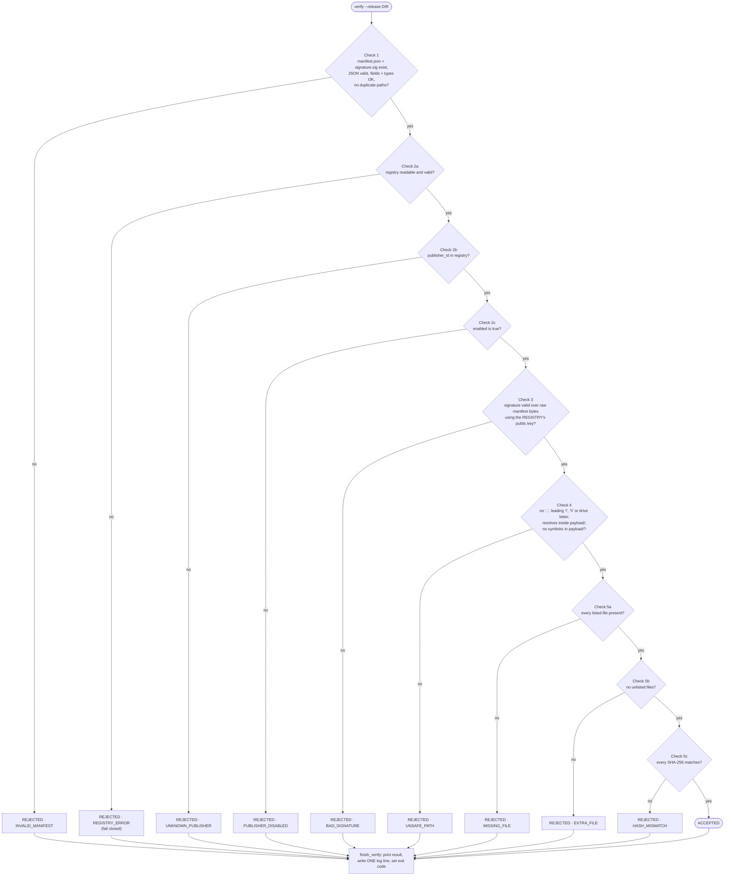

# System Design

This document describes the design **as implemented** in `release_guard.py`. If the code
changes, update this file and the report flowchart to match.

---

## 1. Architecture overview

One Python file, `release_guard.py`, divided into banner-commented sections:

| Section | Main functions | Owner |
|---------|----------------|-------|
| Constants and reason codes | `INVALID_MANIFEST` ... `HASH_MISMATCH`, extra codes, defaults | M1 + M2 |
| Shared helpers | `sha256_file`, `scan_payload`, `load_registry`, `publisher_id_arg` | M1 + M2 |
| Part D: Log | `log_event` | M1 (helper), M2 (wired into verify) |
| Part A: Setup | `cmd_setup`, `prompt_new_passphrase`, `write_new_file` | M1 |
| Part B: Sign | `cmd_sign`, `load_private_key`, `build_manifest_bytes` | M1 |
| Part C: Verify | `cmd_verify`, `check_1_manifest` ... `check_5_payload`, `finish_verify` | M2 |
| CLI | `build_parser`, `main` | M1 + M2 |

`sign` and `verify` share `sha256_file` and `scan_payload`, so hashing and the symlink policy
can never differ between the two sides.

## 2. Publisher and verifier separation

Both parties run on one VM, separated into folders:

```text
PUBLISHER SIDE (holds the secret)            CLIENT SIDE (HarbourView)
publisher_keys/                              verifier/
  harbourview_private.pem  (encrypted)         trusted_publishers.json
                                               keys/harbourview_public.pem
        |                                                ^
        | sign (passphrase via getpass)                  | set up once, out of band
        v                                                |
release_A/  -- travels over an untrusted channel -->  verify --> ACCEPTED / REJECTED + reason
  payload/  manifest.json  signature.sig                 |
                                                         v
                                                  release_log.jsonl
```

**Trust boundary:** the client trusts only its own `verifier/` folder: the registry and the public
keys it lists. **Nothing** inside a release folder is trusted until all five checks pass. A public key
placed inside a release is simply ignored.

## 3. Files and keys

| File / folder | Created by | Read by | Secret? | Trusted by client? |
|---------------|-----------|---------|---------|--------------------|
| `publisher_keys/<id>_private.pem` | setup | sign | **Yes**. Encrypted PEM (PKCS8), mode 0600, never committed or shipped | n/a (client never sees it) |
| `verifier/keys/<id>_public.pem` | setup | verify (check 3) | No | **Yes**: it is the root of trust |
| `verifier/trusted_publishers.json` | setup; edited by the client admin | verify (check 2) | No | **Yes**: decides whose key counts |
| `<release>/payload/**` | publisher | sign, verify (check 5): bytes only | No | No, until ACCEPTED |
| `<release>/manifest.json` | sign | verify (checks 1, 3, 4, 5) | No | No, until check 3 passes |
| `<release>/signature.sig` | sign | verify (check 3) | No | No |
| `release_log.jsonl` | sign, verify | people (audit) | No secrets written | n/a |

## 4. Data flow and cryptographic operations

**setup**
1. Refuse if the private key, the public key or a registry entry for the id already exists. This happens *before* the prompt.
2. `getpass` twice, then reject empty, too short (< 8) or mismatched entries.
3. `Ed25519PrivateKey.generate()`.
4. Private key: `private_bytes(PEM, PKCS8, BestAvailableEncryption(passphrase))`, written with `O_EXCL` and mode 0600.
5. Public key: `public_bytes(PEM, SubjectPublicKeyInfo)`, written to `verifier/keys/`.
6. Append `{publisher_id, public_key_path, enabled: true}` to the registry. Existing entries are preserved.

**sign**
1. Validate `payload/`, the key file, and that there are no symlinks and the payload is not empty.
2. `getpass`, then `load_pem_private_key(..., password)`. A wrong or empty passphrase stops here with nothing written.
3. `sha256_file` on every regular file (64 KiB chunks); paths relative to `payload/` with `/`, sorted.
4. `json.dumps(manifest, indent=2, sort_keys=True) + "\n"`, encoded UTF-8 **once** into `manifest_bytes`.
5. `signature = private_key.sign(manifest_bytes)`; write `manifest_bytes` and the 64-byte `signature`.
6. Log `sign / SIGNED / OK`. Failures are logged as `FAILED / <reason>`.

**verify**: see the flowchart below. The signature is checked over the **raw bytes read from disk**;
the manifest is never re-serialised.

## 5. Manifest format

```json
{
  "files": [
    { "path": "app.py",              "sha256": "<64 lowercase hex>" },
    { "path": "config/settings.ini", "sha256": "<64 lowercase hex>" },
    { "path": "release_notes.txt",   "sha256": "<64 lowercase hex>" }
  ],
  "publisher_id": "harbourview",
  "release_name": "HarbourView lab release 1.0"
}
```

Keys are sorted alphabetically (`sort_keys=True`), which is why `files` appears first.
Check 1 requires: a JSON object; a non-empty string `publisher_id`; a string `release_name`; a non-empty
list `files`; each entry an object with a non-empty string `path` and a 64-hex `sha256`; no duplicate paths.

## 6. Trusted publisher registry

```json
[
  { "publisher_id": "harbourview", "public_key_path": "keys/harbourview_public.pem", "enabled": true }
]
```

- `public_key_path` is resolved relative to the verifier folder.
- `enabled` must be the JSON boolean `true`. Python's `is True` is used, so `"true"`, `1` or a missing value all count as **disabled**.
- The file is re-read on every verify. A missing or corrupt file, or an id listed twice, gives `REGISTRY_ERROR` (fail closed).

## 7. Verification sequence (flowchart, matches the code)



**Why this order**
1. **Structure first**: you cannot use data you cannot parse.
2. **Identity before signature**: the registry entry provides the key that check 3 needs.
3. **Authenticity before content**: an unauthenticated manifest is attacker-controlled text.
4. **Path safety before disk access**: no payload file is opened until every path is known to be safe.
5. **Payload last**: it is the only check that reads payload bytes.

**Code mapping:** `VERIFY_CHECKS` lists the five functions in order; `cmd_verify` loops over them
and stops at the first non-`None` result; `finish_verify` is the only place that prints
`ACCEPTED`/`REJECTED`, writes the log and returns the exit code.

## 8. Logging workflow

`log_event(log_path, operation, release, publisher_id, result, reason)` appends one JSON object per line
to `release_log.jsonl`, with these fields:

| Field | Example | Notes |
|-------|---------|-------|
| `time_utc` | `2026-11-20T19:13:08+00:00` | ISO-8601, UTC, with offset |
| `operation` | `sign` / `verify` | |
| `release` | `scratch/release_T3` | release folder as given on the command line |
| `publisher_id` | `harbourview` or `null` | `null` when check 1 failed before the id could be read |
| `result` | `SIGNED`, `FAILED`, `ACCEPTED`, `REJECTED` | |
| `reason` | `OK` or a reason code | |

Callers never pass keys or passphrases to `log_event`, so they cannot be logged. If the log cannot be
written, a warning is printed and the command's result is unchanged.

## 9. Design decisions summary

| Decision | Choice | Why |
|----------|--------|-----|
| Signature format | Raw 64 bytes | Nothing to decode; any corruption lands on check 3 |
| Serialisation | Once, then sign and write the same bytes | Re-serialising could change spacing and break the signature |
| Path rule | Literal `..` / leading `/` rule, plus `\`, drive letters, and a resolve check | Brief's rule plus defence in depth; false alarms are preferred to missed traversals |
| Symlinks | Refused at sign, `UNSAFE_PATH` at verify | A link could make the tool read outside `payload/` |
| Multi-failure | First failing check; inside check 5: MISSING > EXTRA > HASH | Predictable, documented, and missing files are never hashed |
| Registry failure | `REGISTRY_ERROR`, never accept | A security tool must fail closed |
| Passphrase minimum | 8 characters | Mitigates the weak-passphrase threat |
| Exit codes | 0 / 1 / 2 | Scriptable; argparse already uses 2 for usage errors |
